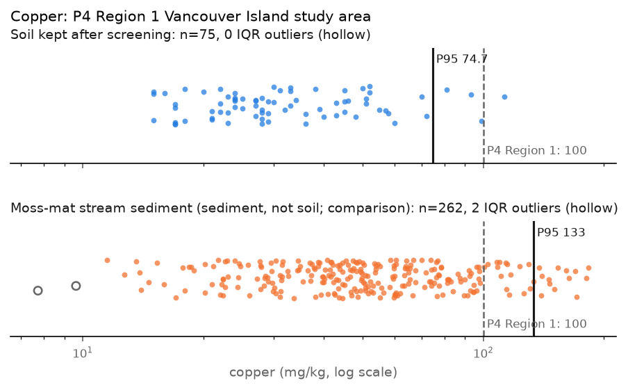

# BC Soil Background Metals Analyzer (Nanaimo–Cowichan)

> **Independent student project.** It isn't affiliated with or endorsed by the Government of British
> Columbia or any report author. **Not for regulatory use.** The numbers here aren't Protocol 4
> background concentrations, and they shouldn't be used to decide whether a site is contaminated.

This project builds one soil metals dataset for the Nanaimo–Cowichan area of Vancouver Island, removes
samples that can't stand for natural background, and estimates 95th-percentile background levels for
arsenic, copper and zinc. The method follows the steps in BC Protocol 4 (v15).

## What it does

1. **Builds one dataset.** pdfplumber extracts the lab tables from 3 public site-investigation reports
   (179 soil samples, 3,592 results). The pipeline joins them with BC open geochemistry: 80 soil samples
   from BCGS GeoFile 2026-02 and 264 RGS 2020 moss-mat sediment sites. The result is one schema in mg/kg
   and BC Albers, loaded into PostGIS: 523 samples and 7,184 results. Each row records its sample medium.
   ([dq_summary](docs/results/dq_summary.md), [extraction check: 60/60 values match the PDF](docs/results/extraction_check.md))
2. **Screens samples for background use.** GeoPandas buffers each soil sample, adding the sample's
   location uncertainty to the buffer. The buffers are checked against nearby land uses (OSM rail, industry,
   fuel, quarries, landfills, pulp mills; MINFILE mines) and each activity's potential contaminants of
   concern (PCOCs), from [`config/activity_pcoc.csv`](config/activity_pcoc.csv). A sample is excluded for a
   metal only when a nearby activity's PCOCs include that metal.
   **Result: 75 of 259 soil samples kept.** ([screening.md](docs/results/screening.md))
3. **Estimates background levels.** For As, Cu and Zn in each region, the steps are: average duplicates;
   replace non-detects with DL/2 (with a sensitivity check); apply a log10 + IQR outlier test; then compute
   n, % non-detect, median, P95 and a bootstrap CI, all with SciPy. ([RESULTS.md](docs/results/RESULTS.md))

## Results (soil kept after screening, mg/kg)

| Metal | Region | n | % non-detect | Median | P95 (95% CI) | Outliers removed | P4 Table 1 Region 1 |
|---|---|---|---|---|---|---|---|
| Arsenic | P4 Region 1, Vancouver Island (study area) | 75 | 27 | 3 | **7.0** (5.3–8.0) | 0 | "(4)" as printed |
| Copper | P4 Region 1, Vancouver Island (study area) | 75 | 0 | 29 | **74.7** (55–99) | 0 | 100 |
| Zinc | P4 Region 1, Vancouver Island (study area) | 74 | 0 | 42.5 | **64.0** (58.1–65.0) | 1 (120) | 150 |

All 75 kept soil samples are in the Cowichan Valley Regional District (Maple Mountain, Assessment Report
29239), so that district's row is identical. No Regional District of Nanaimo soil sample passed screening.
For comparison, the moss-mat stream sediment (**sediment, not soil**; not screened) has a study-area P95 of
As 15.5, Cu 133 and Zn 91.7, with per-district values in RESULTS.md.



## Run it

```bash
docker compose up -d                       # local PostGIS on port 5433
uv run python scripts/download_raw.py      # rebuild git-ignored data/raw/ from public URLs
uv run bcsb                                # extract → locate → geochem → standardize → PostGIS → screen → statistics
uv run pytest                              # 17 tests on synthetic fixtures
```

## Limitations

- **Approximate locations.** Report samples sit at one point per site (150–400 m uncertainty), because
  borehole positions only appear on figures. The uncertainty is added to every screening buffer.
- **Finer sieve on the Maple Mountain samples.** They were sieved to <180 µm, while site investigations
  normally use <2 mm. Finer fractions usually carry more metal, so the comparison with Table 1 isn't
  like for like.
- **Depth and horizon.** The kept samples are C-horizon (about 1 m) road-bank till, while Table 1 uses
  near-surface soil.
- **Sediment kept separate.** RGS moss-mat sediment is a different medium. It is only a labelled
  comparison and never goes into a soil estimate.
- **One district of soil data.** After screening, all kept soil is from one area of Cowichan, so the
  "Region 1" estimate really describes Maple Mountain till. The data fail a single-population test
  (Shapiro-Wilk p < 0.05 on log values), which is reported rather than hidden.
- **Screening rules are judgement calls.** Buffer distances are project assumptions. The PCOC lists cite
  CSAP guidance, the reports themselves and Protocol 4, and the landfill PCOCs are a stated precautionary
  assumption. OSM and MINFILE miss historical land uses.
- **Not a regulatory determination.** There's no qualified professional, no director's approval and no
  purpose-collected samples. See [PROTOCOL_NOTES.md](docs/PROTOCOL_NOTES.md).

## Data sources and attribution

Full list with URLs and licences: [docs/DATA_SOURCES.md](docs/DATA_SOURCES.md).

- Site reports (public PDFs): Tetra Tech EBA DSI, 1 Port Drive Nanaimo (2014); Nanaimo Military Camp
  remediation annexes (2022); Active Earth, Duncan TCH Pathway soil assessment (2023).
  Copyright stays with the authors. Only the extracted numbers are used, and the crops used for the
  extraction check are kept local.
- BC Geological Survey RGS 2020 and MINFILE; BC administrative boundaries. Contains information licensed
  under the Open Government Licence – British Columbia.
- BCGS GeoFile 2026-02 (assessment-report soil geochemistry). Its licence isn't stated, so the data and
  derived per-sample files are **not in git**. The pipeline downloads them and rebuilds them locally.
- © OpenStreetMap contributors, ODbL (land uses, geocoding).
- BC Protocol 4 v15; CSAP Society *PCOCs at Select Commercial and Industrial Land Uses* v1.0 (2018).

Code: MIT licence ([LICENSE](LICENSE)).
