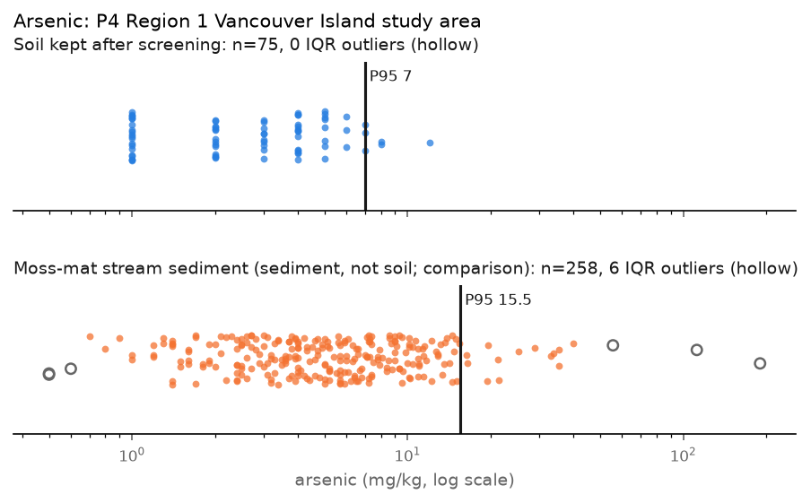
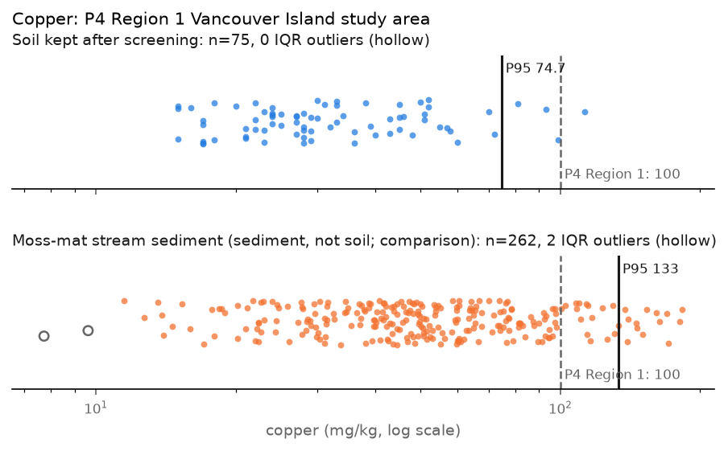
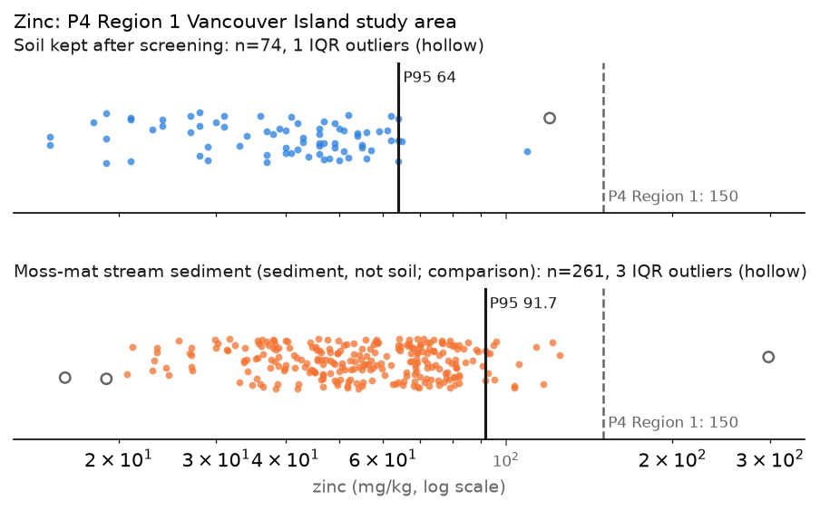

# Background estimates for arsenic, copper and zinc

Generated by `src/bc_soil_background/analysis/background.py` (`uv run bcsb`). Units: mg/kg (= µg/g).
Not for regulatory use: see the README's limitations.

## Soil, after screening (main estimate, non-detects = DL/2)

| metal   | region                                    |   n |   % non-detect |   median |   P95 | P95 95% CI (bootstrap)   | IQR outliers removed   |   Shapiro p (log) | P4 Table 1 Region 1   |
|:--------|:------------------------------------------|----:|---------------:|---------:|------:|:-------------------------|:-----------------------|------------------:|:----------------------|
| As      | P4 Region 1 Vancouver Island (study area) |  75 |             27 |      3   |   7   | 5.3–8                    | 0                      |          3.26e-05 | (4)                   |
| As      | Cowichan Valley Regional District         |  75 |             27 |      3   |   7   | 5.3–8                    | 0                      |          3.26e-05 | (4)                   |
| Cu      | P4 Region 1 Vancouver Island (study area) |  75 |              0 |     29   |  74.7 | 55–99                    | 0                      |          0.0219   | 100                   |
| Cu      | Cowichan Valley Regional District         |  75 |              0 |     29   |  74.7 | 55–99                    | 0                      |          0.0219   | 100                   |
| Zn      | P4 Region 1 Vancouver Island (study area) |  74 |              0 |     42.5 |  64   | 58.1–65                  | 1 (120)                |          0.00806  | 150                   |
| Zn      | Cowichan Valley Regional District         |  74 |              0 |     42.5 |  64   | 58.1–65                  | 1 (120)                |          0.00806  | 150                   |

Regions are Protocol 4 Region 1 (Vancouver Island; the whole study area) and the BC regional
districts inside it. Regional District of Nanaimo has no soil row because none of its soil samples passed screening (all came from investigated contaminated-site reports).

## Sensitivity to the non-detect method (soil, P4 Region 1)

| analyte   |   DL/2 |   ND=0 |   ND=DL |
|:----------|-------:|-------:|--------:|
| As        |    7   |    7   |     7   |
| Cu        |   74.7 |   74.7 |    74.7 |
| Zn        |   64   |   64   |    64   |

## Comparison: moss-mat stream sediment (sediment, not soil; not screened)

| metal   | region                                    |   n |   % non-detect |   median |    P95 | P95 95% CI (bootstrap)   | IQR outliers removed              |   Shapiro p (log) |
|:--------|:------------------------------------------|----:|---------------:|---------:|-------:|:-------------------------|:----------------------------------|------------------:|
| As      | P4 Region 1 Vancouver Island (study area) | 258 |              0 |     5.15 |  15.5  | 13.7–21.9                | 6 (0.5, 0.5, 0.6, 55.6, 112, 190) |            0.622  |
| As      | Capital Regional District                 |  20 |              0 |     2.45 |   6.74 | 5.51–11.4                | 0                                 |            0.207  |
| As      | Cowichan Valley Regional District         | 175 |              0 |     5.9  |  16.4  | 13.7–21.5                | 4 (0.5, 40, 55.6, 190)            |            0.618  |
| As      | Regional District of Nanaimo              |  63 |              0 |     4    |  14.4  | 9.48–28.8                | 2 (0.5, 112)                      |            0.232  |
| Cu      | P4 Region 1 Vancouver Island (study area) | 262 |              0 |    49.8  | 133    | 114–150                  | 2 (7.73, 9.62)                    |            0.378  |
| Cu      | Capital Regional District                 |  19 |              0 |    47.1  |  80.4  | 60.5–92.6                | 1 (9.62)                          |            0.74   |
| Cu      | Cowichan Valley Regional District         | 177 |              0 |    51.5  | 131    | 114–150                  | 2 (7.73, 11.5)                    |            0.153  |
| Cu      | Regional District of Nanaimo              |  65 |              0 |    44.4  | 140    | 81.9–164                 | 0                                 |            0.204  |
| Zn      | P4 Region 1 Vancouver Island (study area) | 261 |              0 |    55.7  |  91.7  | 83.7–96.1                | 3 (16, 19, 298)                   |            0.0026 |
| Zn      | Capital Regional District                 |  20 |              0 |    49    |  81.5  | 66.1–90.6                | 0                                 |            0.167  |
| Zn      | Cowichan Valley Regional District         | 174 |              0 |    65.3  |  95    | 88.6–106                 | 5 (16, 21.2, 23.2, 23.4, 298)     |            0.0116 |
| Zn      | Regional District of Nanaimo              |  65 |              0 |    43.3  |  71.3  | 65.7–79.3                | 0                                 |            0.707  |

## Plots

## Method

1. Soil samples kept by `screening.py` for that metal (see [screening.md](screening.md)).
2. Duplicates averaged with their parent and counted once (P4 v15 s.4.2.1).
3. Non-detects = half the detection limit; ND = 0 and ND = DL shown above as a sensitivity check.
4. log10 transform, then Tukey IQR rule (1.5 × IQR) with `scipy.stats.iqr` /
   `scipy.stats.scoreatpercentile`; outliers removed (P4 v15 s.4.2.1).
5. n, % non-detect, median and P95 with `scipy.stats.scoreatpercentile`; bootstrap CI with
   `scipy.stats.bootstrap` (5,000 resamples, seed 42); Shapiro-Wilk on log values with
   `scipy.stats.shapiro` (p < 0.05 suggests the data may not be one log-normal population).
